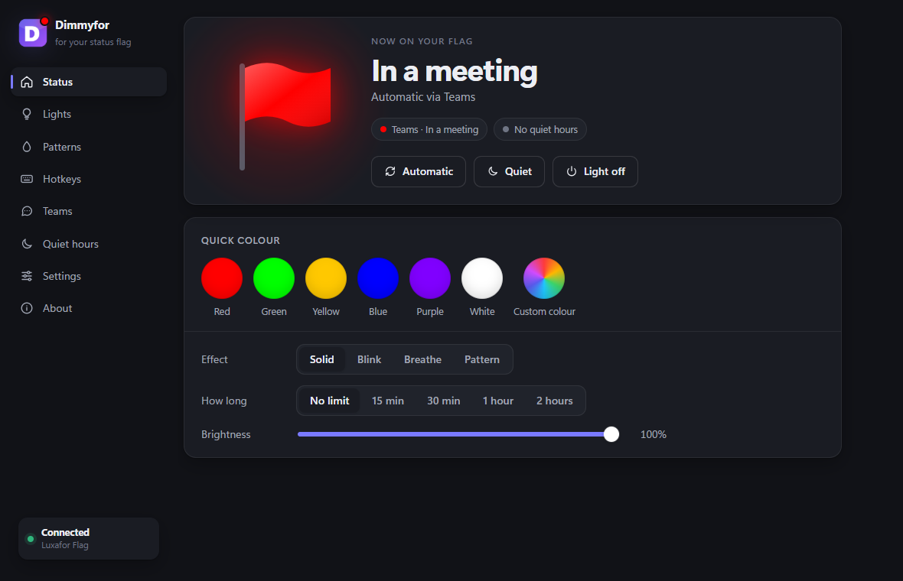
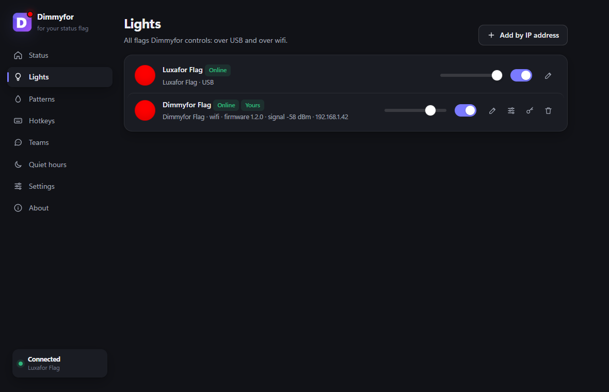
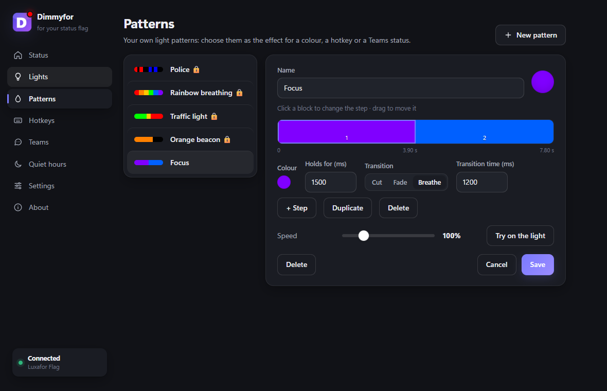
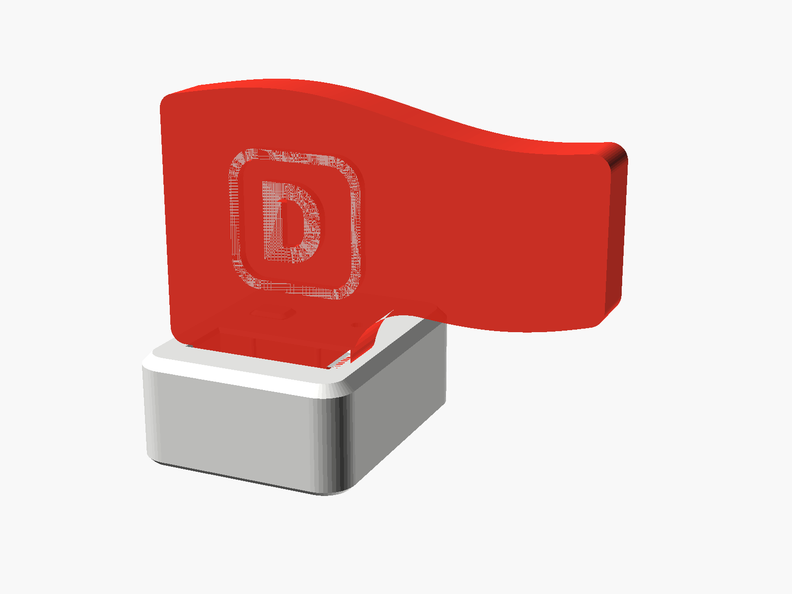

# Dimmyfor

Dimmyfor is a small Windows app that turns a **Luxafor Flag** or a **Dimmyfor Flag** into a status light. Your flag follows your Microsoft Teams status, you set a colour with one key, and during quiet hours it stays off.

This repository holds the downloads and the signed updates. The app checks it for new versions by itself.



## Download and install

1. Download `Dimmyfor-<version>-installer.zip` from the [latest release](https://github.com/dimitrihilverda/dimmyfor-releases/releases/latest).
2. Unzip it (right-click → Extract All).
3. Plug your Luxafor Flag or Dimmyfor Flag into a USB port.
4. Double-click `install.cmd`. No administrator rights are needed. If Windows SmartScreen warns you, choose "More info" → "Run anyway".
5. Dimmyfor starts by itself and shows up as a "D" icon next to the clock. Can't see it? Click the ^ arrow next to the clock.

To update later: Dimmyfor → About → Update, or run `install.cmd` from a newer zip. To remove it: `uninstall.cmd`. Your settings stay in `%APPDATA%\Dimmyfor`.

Requirements: Windows 10 or 11 with Microsoft Edge WebView2 (built into Windows 11).

## What it does

- **Follows Teams:** available, busy, in a meeting, presenting, do not disturb, away. The status is read from the local Teams log file; no sign-in or connection to Microsoft is needed. You choose the colour and effect for each status.
- **Hotkeys:** set a colour, blink or turn the light off from anywhere in Windows, even when the window is closed.
- **Quiet hours:** the light turns off in the evening and at the weekend, on your own schedule.
- **Patterns:** your own light patterns with a timeline editor, as an effect for a colour, a hotkey or a Teams status.
- **Several lights:** over USB and over Wi-Fi, each with its own brightness.
- **Languages:** English, Dutch and German. Dimmyfor follows the Windows language; you can change it under Settings → Language.





## The Dimmyfor Flag

The Dimmyfor Flag is a status flag built around an ESP32-S3 Super Mini in a 3D-printed case. It speaks the same USB protocol as the Luxafor Flag, and it does more:

- **Wi-Fi:** on a USB charger, without a computer. Dimmyfor sends the status over the network, with a signature on every message.
- **Claiming:** a flag belongs to at most four Dimmyfor installations. Only they can control it over Wi-Fi.
- **Firmware updates from the app,** over USB or over Wi-Fi, with an automatic rollback if a new version does not start properly.
- **Wi-Fi setup** from the app over USB, or with a phone through the flag's own hotspot.
- **Roaming** (since firmware 1.2.1): the flag picks the strongest access point, and switches to a stronger one when the signal gets weak.



## Release files

Each release contains:

| File | What it is |
|---|---|
| `Dimmyfor-<version>-installer.zip` | The app, with `install.cmd`, `uninstall.cmd`, `luxafor.exe` and a readme in English, Dutch and German |
| `dimmyfor-vlag-<version>.bin`, `dimmyfor-vlag-otadata.bin` | Firmware for the Dimmyfor Flag (updating an existing flag keeps its owners and Wi-Fi) |
| `dimmyfor-vlag-bootloader.bin`, `dimmyfor-vlag-partitions.bin` | Only for installing a brand-new board |
| `manifest.json`, `manifest.json.sig` | What is in the release, with SHA-256 checksums, signed with Ed25519 |

The app only installs an update when the manifest has a valid signature and every file matches its checksum.

## Command line

The installer also puts `luxafor.exe` in the install folder (`%LOCALAPPDATA%\Programs\Dimmyfor`), for scripts:

```
luxafor color red
luxafor strobe blue
luxafor pattern rainbow
luxafor off
```

Run `luxafor --help` for all options.

---

Made by Dimitri Hilverda.
